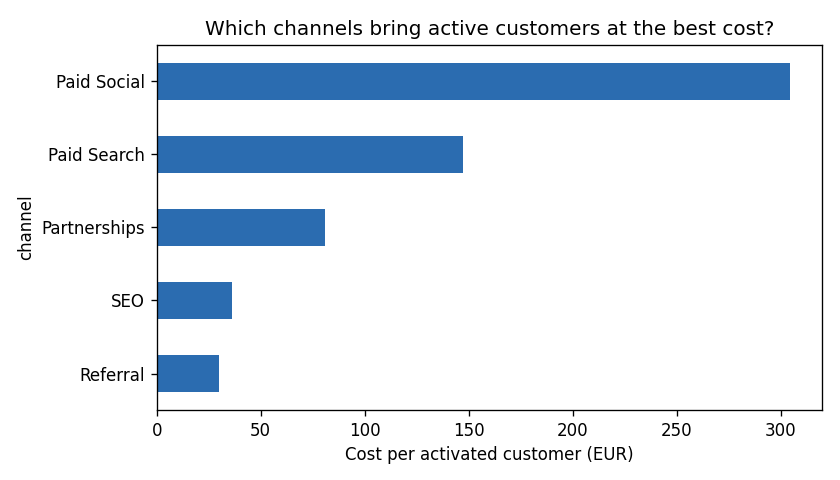
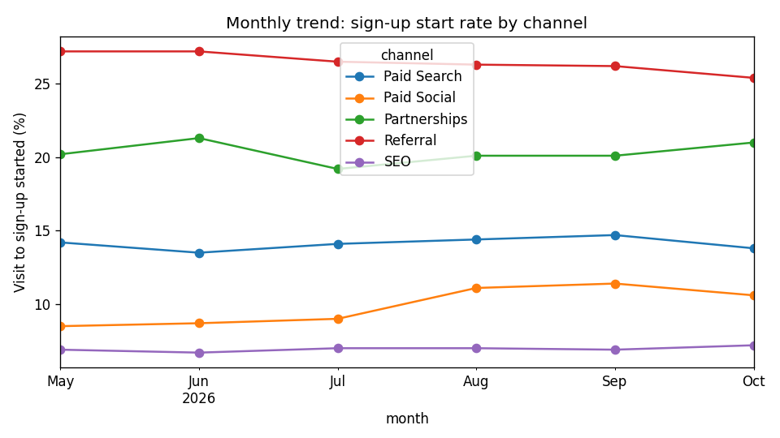

# Acquisition Funnel Insights

An analysis of the acquisition funnel of a B2B online business account, from first website visit to active customer. The goal: show business teams where prospects drop off, which channels bring customers who really use the product, and what to do about it.

Note: the data is simulated (263,000 visitors over 6 months) with a fixed random seed, so every result can be reproduced.

## The funnel

```
website visit -> sign-up started -> sign-up completed -> account opened -> activated (first transaction)
```

## Main results

| Channel | Visit to activated | Activation rate after opening | Cost per activated customer |
|---|---|---|---|
| Referral | 10.5% | 71.0% | 30 EUR |
| SEO | 1.7% | 58.8% | 36 EUR |
| Partnerships | 7.0% | 66.9% | 81 EUR |
| Paid Search | 3.1% | 54.1% | 147 EUR |
| Paid Social | 1.0% | 38.9% | 305 EUR |



Key insights (full write-up in [reports/summary.md](reports/summary.md)):
1. **Paid Social costs 10 times more than Referral** for one active customer, and its sign-ups activate much less.
2. **Mobile users drop off more in the sign-up form** (51.5% finish against 60.2% on desktop). Fixing it would bring about 1,150 extra sign-ups in six months with no extra spend.
3. **The median time to first transaction is 10 days**, so the first week after opening is the moment for an activation journey.



The monthly trend shows the effect of a Paid Social landing page change in August (sign-up start rate from about 9% to 11%).

## How it works

1. `data/generate_data.py` creates the visitors, funnel events and monthly spend per channel.
2. Five SQL queries in `sql/` answer one business question each:
   - `01_funnel_by_channel.sql`: visitors reaching each step and step-to-step conversion
   - `02_channel_efficiency.sql`: cost per account opened and per activated customer
   - `03_monthly_trend.sql`: monthly conversion by channel
   - `04_device_dropoff.sql`: sign-up completion on mobile and desktop
   - `05_time_to_activation.sql`: median and 90th percentile days to first transaction
3. `src/run_analysis.py` runs the queries with DuckDB, saves each result as CSV and draws the charts.
4. `reports/summary.md` turns the numbers into 3 recommendations for non-technical teams.

## Looker Studio dashboard

The CSV files in `reports/` are ready for Looker Studio: upload them to Google Sheets, add each sheet as a data source in Looker Studio, then build a scorecard (activated customers), a funnel bar chart by channel, a cost per activated table and a monthly trend line.

## How to run

```bash
pip install -r requirements.txt
python data/generate_data.py
python -m src.run_analysis
python -m pytest -q          # tests check the SQL logic on a tiny dataset with known answers
```

## Tech stack

SQL (DuckDB), Python (pandas, matplotlib), Looker Studio, pytest

## Author

Saiteja Eleti - [LinkedIn](https://www.linkedin.com/in/saiteja-eleti-169028332/)
